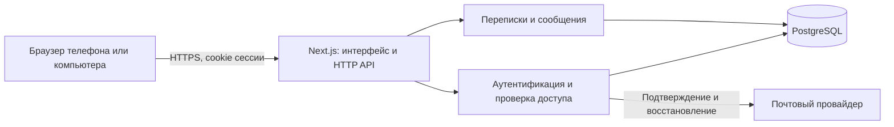

# Архитектура Lyns

Это план первой рабочей версии. Сейчас реализован только интерфейс с локальными данными; перечисленные ниже серверные модули, таблицы и API ещё не созданы.

## Основные решения

Начинаем с одного приложения Next.js на TypeScript и одной базы PostgreSQL. React отвечает за интерактивность, Next.js Route Handlers — за HTTP API. Логику доступа и работу с базой размещаем в серверных модулях отдельно от компонентов. Это позволяет начать без отдельных микросервисов и позже выделить доставку событий при необходимости.



## Модули

| Область | Ответственность |
| --- | --- |
| Интерфейс | Формы входа, список диалогов, история, черновики, ошибки и состояния загрузки |
| Аутентификация | Регистрация, пароли, подтверждение email, сессии и восстановление |
| Пользователи | Публичное имя, профиль, поиск; email не публикуется |
| Переписки | Создание личного диалога, список участников, проверка доступа |
| Сообщения | Запись, постраничная история, защита от повторной отправки |
| Почта | Отправка ссылок, ограничение частоты, повторы после ошибок |

Предлагаемая структура по мере появления серверной реализации:

```text
src/
  app/          Страницы и HTTP-маршруты
  components/   Компоненты интерфейса
  features/     Клиентские сценарии auth и chat
  server/       Серверные сервисы, доступ к данным и почте
  lib/          Общие типы и схемы проверки входных данных
```

Серверные модули не импортируются в клиентские компоненты; секреты остаются на сервере.

## Модель данных

| Таблица | Основные поля и ограничения |
| --- | --- |
| users | id, email_normalized (unique), public_handle (unique), display_name, password_hash, email_verified_at, created_at |
| sessions | id, user_id, token_hash (unique), expires_at; отзыв при выходе |
| email_tokens | id, user_id, purpose, token_hash (unique), expires_at, consumed_at |
| conversations | id, type=direct, direct_pair_key (unique), created_at |
| conversation_members | conversation_id + user_id (составной ключ), joined_at |
| messages | id, conversation_id, sender_id, client_message_id, body, created_at |

Внешние ключи связывают записи. Для первой версии у личной переписки ровно два участника; создание пары и участников выполняется одной транзакцией. `direct_pair_key` строится из отсортированных id пользователей и исключает дубли личного диалога при одновременных запросах.

Индекс сообщений: `(conversation_id, created_at, id)`. История загружается порциями по курсору `(created_at, id)` со стабильным порядком. Уникальность `(sender_id, client_message_id)` позволяет безопасно повторить отправку после сетевой ошибки; сервер проверяет принадлежность повторного запроса тому же диалогу и возвращает исходную запись.

## Регистрация и безопасность

- Регистрация по имени, email и паролю. Публичный уникальный handle нужен для поиска без раскрытия почты.
- Пароли хешируются Argon2id проверенной библиотекой; в базе нет исходных паролей.
- Подтверждение email и сброс пароля используют случайные одноразовые токены с ограниченным сроком. В базе хранятся только хеши токенов.
- Сессия передаётся в cookie с `HttpOnly`, `Secure` в production и `SameSite=Lax`; изменяющие запросы защищены проверкой Origin/CSRF.
- До подтверждения почты отправка сообщений закрыта. Восстановление не раскрывает, зарегистрирован ли адрес.
- Сервер проверяет участника диалога при каждом чтении и записи, а не доверяет user_id из браузера.
- Сервер ограничивает длину сообщения (до 4000 символов), частоту входа, поиска, отправки и писем. Текст выводится как текст, без интерпретации HTML.
- После сброса пароля прежние сессии отзываются. В логи не попадают пароли, токены и тексты личных сообщений.

Первая версия не предусматривает сквозное шифрование: сервер получает текст сообщений. Для production необходимы HTTPS, резервное копирование и контролируемый доступ к базе.

## Предлагаемые HTTP-маршруты

| Метод и маршрут | Назначение |
| --- | --- |
| POST /api/auth/register | Регистрация и письмо подтверждения |
| POST /api/auth/login | Создание сессии |
| POST /api/auth/logout | Отзыв текущей сессии |
| POST /api/auth/verify-email | Одноразовое подтверждение токена |
| POST /api/auth/resend-verification | Повтор письма с ограничением частоты |
| POST /api/auth/forgot-password | Запрос восстановления |
| POST /api/auth/reset-password | Смена пароля по токену |
| GET /api/me | Текущий профиль |
| GET /api/users?handle=... | Поиск по точному публичному handle |
| GET /api/conversations | Список собственных диалогов с пагинацией |
| POST /api/conversations | Создать или получить личный диалог по id собеседника |
| GET /api/conversations/:id/messages | История по курсору; новые сообщения после курсора |
| POST /api/conversations/:id/messages | Записать сообщение с client_message_id |

Все маршруты чата требуют сессии. Ошибки имеют стабильный код и понятный текст; ответы не раскрывают данные чужих переписок. API — план, не действующий контракт.

## Доставка сообщений

Для первого рабочего среза используем запрос отправки и опрос новых сообщений раз в 3 секунды, пока диалог открыт и вкладка активна. При возвращении во вкладку загружаем пропущенные сообщения; после ошибок увеличиваем интервал повторов. Список диалогов обновляем отдельно с ограничением частоты. Это даст проверяемый обмен между двумя пользователями с небольшой задержкой без отдельной инфраструктуры соединений.

Отправка считается сохранённой только после ответа сервера. Повтор использует тот же client_message_id. Состояния «отправляется», «сохранено» и «ошибка» отделены от прочтения: отметки о прочтении в этот этап не входят.

Для мгновенной доставки следующим этапом можно добавить WebSocket или SSE с учётом платформы размещения. PostgreSQL остаётся источником истины, после переподключения клиент восстанавливает историю по курсору. Выбор хостинга и транспорта согласуем до реализации постоянных соединений.

## Этапы и критерии готовности

1. **Прототип (сейчас):** список, диалог, поиск и локальная отправка; проверка на телефоне и компьютере.
2. **Аккаунты:** PostgreSQL, миграции, регистрация, подтверждение, вход/выход, восстановление. Проверки истечения токенов, отзыва сессий и повторного email.
3. **Переписки:** поиск пользователей, создание диалога, сохранение и загрузка сообщений. Две независимые сессии видят общий диалог; третий пользователь не может читать или писать в него.
4. **Обновления:** опрос новых сообщений, отсутствие дублей при повторе, восстановление после разрыва сети. Сообщения остаются после перезагрузки и перезапуска сервера.
5. **Подготовка к размещению:** почтовый провайдер, HTTPS, миграции при выпуске, резервное копирование с проверкой восстановления, лимиты и мониторинг ошибок.

Для серверной части нужны интеграционные тесты на PostgreSQL и браузерные проверки с двумя пользователями. Текущие проверки интерфейса не подтверждают работу будущего backend.

## За пределами первой версии

Групповые чаты, вложения, звонки, поиск по тексту, сквозное шифрование, push-уведомления, статусы присутствия, прочтение и нативные приложения. Redis, очереди и отдельный сервис доставки добавляются по измеренной необходимости.

## Что потребуется перед backend-этапом

Выбрать библиотеку аутентификации, инструмент миграций и доступа к PostgreSQL, хостинг и почтового провайдера. Проверить возможности выбранных библиотек для паролей и сессий. Учётные данные задаются через настройки среды, не через исходники или чат. Для текущего прототипа эти решения и секреты не нужны.
